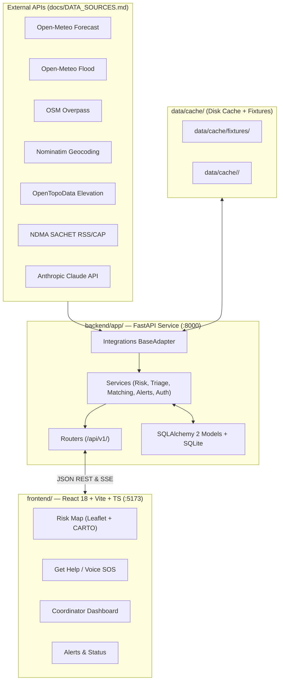

# FloodSaathi — Architecture Document

> **Hackathon Edition** · Version 1.0 · References: PRD.md, DESIGN.md

---

## System Diagram



    OM -->|fetch with timeout+retry| DT
    OF -->|fetch with timeout+retry| DT
    OV -->|fetch with timeout+retry| DT
    NT -->|fetch with timeout+retry| DT
    TD -->|fetch with timeout+retry| DT
    DT -->|miss: write| Cache
    Cache -->|hit: read| DT
    DT --> RK
    DT --> TR
    CL -->|triage prompt| TR
    RK --> DB
    TR --> DB
    MT --> DB
    AL --> DB
    DB --> Storage
    RK --> P1
    TR --> P2
    MT --> P2
    MT --> P3
    AL --> P4
    DB --> P3
```

---

## Folder Structure

```
floodsaathi/
├── app.py                   # Streamlit entry point (navigation only)
├── .env                     # API keys — never committed
├── .env.example             # Template committed to repo
├── requirements.txt
├── PRD.md
├── DESIGN.md
├── ARCHITECTURE.md
├── DATABASE.md
├── API.md
├── AGENTS.md
├── README.md
│
├── pages/
│   ├── 1_Risk_Map.py
│   ├── 2_Help_Request.py
│   ├── 3_Dashboard.py
│   └── 4_Alerts.py
│
├── src/
│   ├── data/
│   │   ├── __init__.py
│   │   ├── fetcher.py        # Generic HTTP fetch with timeout + retry + cache
│   │   ├── weather.py        # Open-Meteo Forecast API wrapper
│   │   ├── flood.py          # Open-Meteo Flood API wrapper
│   │   ├── facilities.py     # Overpass API → hospitals, shelters, schools
│   │   ├── elevation.py      # OpenTopoData wrapper
│   │   └── geocoder.py       # Nominatim wrapper + fuzzy district match
│   │
│   ├── risk/
│   │   ├── __init__.py
│   │   ├── engine.py         # Rule-based risk scorer (returns Low/Med/High/Severe)
│   │   ├── ml_model.py       # Optional scikit-learn classifier (future)
│   │   └── explainer.py      # Produces the one-sentence explanation string
│   │
│   ├── triage/
│   │   ├── __init__.py
│   │   ├── llm.py            # Claude prompt builder + response parser
│   │   ├── fallback.py       # Keyword-based extraction (no API needed)
│   │   └── validator.py      # Pydantic model for triage JSON
│   │
│   ├── matching/
│   │   ├── __init__.py
│   │   ├── haversine.py      # Distance calculation
│   │   └── matcher.py        # Greedy nearest-available assignment
│   │
│   ├── db/
│   │   ├── __init__.py
│   │   ├── schema.sql        # CREATE TABLE statements
│   │   ├── init_db.py        # One-time DB setup + seed
│   │   └── queries.py        # Named query functions (no raw SQL in pages)
│   │
│   └── alerts/
│       ├── __init__.py
│       └── generator.py      # Claude prompt → Hindi + English alert text
│
├── data/
│   ├── cache/
│   │   ├── weather_cache.json
│   │   ├── flood_cache.json
│   │   ├── geocode_cache.json
│   │   └── facilities_cache.json
│   └── seed/
│       ├── districts.json    # District metadata (name, bbox, centroid)
│       ├── volunteers.json   # 20 synthetic volunteers
│       └── requests.json     # 100 synthetic help requests
│
└── tests/
    ├── test_risk.py
    ├── test_triage.py
    ├── test_matching.py
    ├── triage_labels.json    # 30 labelled messages for accuracy test
    └── conftest.py
```

---

## Module Responsibilities

| Module | Responsibility | External dependency |
|--------|---------------|---------------------|
| `src/data/fetcher.py` | HTTP GET with 5 s timeout, 1 retry, cache read/write | `requests` |
| `src/data/weather.py` | Fetch hourly precipitation forecast for lat/lon | Open-Meteo |
| `src/data/flood.py` | Fetch hourly river discharge for lat/lon | Open-Meteo Flood |
| `src/data/facilities.py` | Query hospitals/shelters/schools in a bounding box | Overpass |
| `src/data/geocoder.py` | Resolve district name or free text to lat/lon | Nominatim |
| `src/risk/engine.py` | Score district risk from weather + discharge thresholds | none |
| `src/risk/explainer.py` | Return human-readable reason for the score | none |
| `src/triage/llm.py` | Call Claude, parse triage JSON | Anthropic |
| `src/triage/fallback.py` | Keyword extraction when Claude unavailable | none |
| `src/matching/matcher.py` | Assign nearest available shelter/hospital/volunteer | none |
| `src/db/queries.py` | All DB reads/writes; returns typed dicts | SQLite |
| `src/alerts/generator.py` | Generate bilingual alert text | Anthropic |

---

## Data Flows

### A — Risk Computation (runs hourly or on page load)

```
1. pages/1_Risk_Map.py calls src/risk/engine.compute_all_districts()
2. engine reads district centroids from DB
3. For each district:
   a. src/data/weather.get_forecast(lat, lon) → hourly precip (48 h)
   b. src/data/flood.get_discharge(lat, lon)  → hourly discharge (48 h)
   c. src/data/elevation.get_elevation(lat, lon) → metres ASL
   d. engine.score() applies threshold rules (see formula in README)
   e. src/risk/explainer.explain() returns a string
4. DB upsert: risk_scores table (district_id, level, explanation, computed_at)
5. Streamlit reads risk_scores and renders Folium choropleth
```

### B — Help Request Lifecycle

```
1. User types message in pages/2_Help_Request.py
2. src/triage/llm.triage(raw_text) calls Claude
   └─ On failure: src/triage/fallback.extract(raw_text)
3. src/data/geocoder.resolve(location_string) → (lat, lon)
4. DB insert: help_requests (status=new, all parsed fields)
5. src/matching/matcher.assign(request_id) runs:
   a. SELECT available volunteers, shelters, hospitals from DB
   b. haversine distance for each candidate
   c. Pick nearest; update volunteer.available=False if assigned
   d. DB insert: assignments (request_id, resource_type, resource_id, distance_km)
6. DB update: help_requests.status = assigned
7. Streamlit re-renders RequestCard + Folium map lines
```

---

## Caching Strategy

| Data type | TTL | Cache file | Fallback behaviour |
|-----------|-----|------------|-------------------|
| Weather forecast | 1 hour | `weather_cache.json` | Use last valid cache; show stale banner |
| Flood / discharge | 1 hour | `flood_cache.json` | Same |
| Facilities (Overpass) | 24 hours | `facilities_cache.json` | Seed data from `data/seed/` |
| Geocoding results | 7 days | `geocode_cache.json` | Return district centroid |
| Risk scores | Derived | DB `risk_scores` table | Last DB row |

Cache key = `f"{endpoint}_{params_hash}"`. Cache files are plain JSON arrays; `fetcher.py` checks `computed_at` timestamp before calling the live API.

---

## Error Handling Rules

1. **Every external HTTP call** must specify `timeout=5` and catch `requests.Timeout` / `requests.ConnectionError`.
2. On failure, log the error and **return the cached value**. If no cache exists, return `None` and let the UI show an error banner.
3. **Claude calls** get a single retry with exponential backoff (1 s, 2 s). After two failures, fall back to `src/triage/fallback.py`.
4. **DB errors** are fatal; bubble up to Streamlit's `st.exception()` with a user-friendly message.
5. **Never raise** unhandled exceptions in page code; wrap in `try/except` and call `st.error()`.

---

## Configuration (`.env`)

```
ANTHROPIC_API_KEY=sk-...
OPEN_METEO_BASE_URL=https://api.open-meteo.com/v1
OPEN_METEO_FLOOD_URL=https://flood-api.open-meteo.com/v1
OVERPASS_URL=https://overpass-api.de/api/interpreter
NOMINATIM_URL=https://nominatim.openstreetmap.org
OPENTOPODATA_URL=https://api.opentopodata.org/v1
DB_PATH=floodsaathi.db
CACHE_DIR=data/cache
CACHE_TTL_WEATHER_H=1
CACHE_TTL_FACILITIES_H=24
LOG_LEVEL=INFO
```

All values read via `python-dotenv`; **never** use `os.environ["KEY"]` directly in module code — always use a `config.py` getter that fails fast with a clear message.

---

## Key Architectural Decisions

| Decision | Choice | Reason |
|----------|--------|--------|
| Frontend framework | Streamlit | Fastest path from Python to interactive UI; no JS required; hackathon-appropriate |
| Database | SQLite | Zero-ops, single file, WAL mode handles Streamlit's rerun concurrency |
| Map library | Folium + streamlit-folium | Best-in-class Python Folium integration; Leaflet under the hood |
| Risk model | Rule-based first, ML optional | Rules are explainable, debuggable in < 2 hours; scikit-learn hook ready for post-hackathon |
| LLM | Anthropic Claude | Superior structured JSON extraction in Hinglish; function calling available |
| HTTP client | `requests` | Simple, synchronous; Streamlit is single-threaded anyway |
| Geocoding | Nominatim | Free, no API key, good India coverage; rate limit 1 req/s handled by cache |
| Elevation | OpenTopoData | Free SRTM data; used as one risk factor for low-lying areas |
