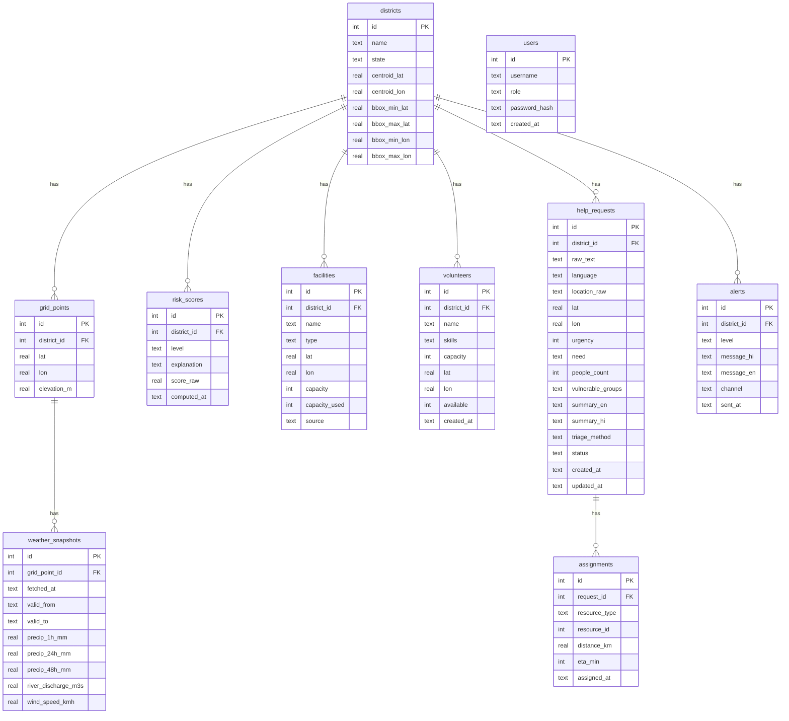

# FloodSaathi — Database Design Document

> **Hackathon Edition** · Version 1.0 · References: ARCHITECTURE.md

---

## ER Diagram

---

## Table Definitions

### `districts`
| Column | Type | Constraints | Notes |
|--------|------|------------|-------|
| `id` | INTEGER | PK AUTOINCREMENT | |
| `name` | TEXT | NOT NULL UNIQUE | e.g. "Morigaon" |
| `state` | TEXT | NOT NULL | e.g. "Assam" |
| `centroid_lat` | REAL | NOT NULL | Decimal degrees |
| `centroid_lon` | REAL | NOT NULL | |
| `bbox_min_lat` | REAL | | Bounding box for Overpass |
| `bbox_max_lat` | REAL | | |
| `bbox_min_lon` | REAL | | |
| `bbox_max_lon` | REAL | | |

### `grid_points`
| Column | Type | Constraints | Notes |
|--------|------|------------|-------|
| `id` | INTEGER | PK AUTOINCREMENT | |
| `district_id` | INTEGER | FK → districts.id | |
| `lat` | REAL | NOT NULL | |
| `lon` | REAL | NOT NULL | |
| `elevation_m` | REAL | | From OpenTopoData |

### `weather_snapshots`
| Column | Type | Constraints | Notes |
|--------|------|------------|-------|
| `id` | INTEGER | PK AUTOINCREMENT | |
| `grid_point_id` | INTEGER | FK → grid_points.id | |
| `fetched_at` | TEXT | NOT NULL | ISO 8601 |
| `valid_from` | TEXT | NOT NULL | Forecast window start |
| `valid_to` | TEXT | NOT NULL | Forecast window end |
| `precip_1h_mm` | REAL | | mm in next 1 h |
| `precip_24h_mm` | REAL | | mm cumulative 24 h |
| `precip_48h_mm` | REAL | | mm cumulative 48 h |
| `river_discharge_m3s` | REAL | | m³/s |
| `wind_speed_kmh` | REAL | | |

### `risk_scores`
| Column | Type | Constraints | Notes |
|--------|------|------------|-------|
| `id` | INTEGER | PK AUTOINCREMENT | |
| `district_id` | INTEGER | FK → districts.id | |
| `level` | TEXT | CHECK IN ('low','medium','high','severe') | |
| `explanation` | TEXT | | Plain-language reason |
| `score_raw` | REAL | | 0.0–1.0 composite |
| `computed_at` | TEXT | NOT NULL | ISO 8601 |

Index: `(district_id, computed_at DESC)` for latest-score query.

### `facilities`
| Column | Type | Constraints | Notes |
|--------|------|------------|-------|
| `id` | INTEGER | PK AUTOINCREMENT | |
| `district_id` | INTEGER | FK → districts.id | |
| `name` | TEXT | NOT NULL | |
| `type` | TEXT | CHECK IN ('hospital','shelter','school') | |
| `lat` | REAL | NOT NULL | |
| `lon` | REAL | NOT NULL | |
| `capacity` | INTEGER | DEFAULT 0 | Max people |
| `capacity_used` | INTEGER | DEFAULT 0 | Current occupancy |
| `source` | TEXT | | "overpass" or "seed" |

Index: `(lat, lon)` for spatial queries.

### `volunteers`
| Column | Type | Constraints | Notes |
|--------|------|------------|-------|
| `id` | INTEGER | PK AUTOINCREMENT | |
| `district_id` | INTEGER | FK → districts.id | |
| `name` | TEXT | NOT NULL | Synthetic only |
| `skills` | TEXT | | Comma-separated: "rescue,first-aid" |
| `capacity` | INTEGER | DEFAULT 1 | Max concurrent assignments |
| `lat` | REAL | NOT NULL | |
| `lon` | REAL | NOT NULL | |
| `available` | INTEGER | DEFAULT 1 | 0=unavailable, 1=available |
| `created_at` | TEXT | NOT NULL | |

Index: `(available, lat, lon)`.

### `help_requests`
| Column | Type | Constraints | Notes |
|--------|------|------------|-------|
| `id` | INTEGER | PK AUTOINCREMENT | |
| `district_id` | INTEGER | FK → districts.id | Resolved after geocoding |
| `raw_text` | TEXT | NOT NULL | Original message |
| `language` | TEXT | CHECK IN ('en','hi','hinglish') | Detected by LLM |
| `location_raw` | TEXT | | Extracted location string |
| `lat` | REAL | | Geocoded |
| `lon` | REAL | | Geocoded |
| `urgency` | INTEGER | CHECK BETWEEN 1 AND 5 | 5 = critical |
| `need` | TEXT | CHECK IN ('rescue','medical','food','shelter','other') | |
| `people_count` | INTEGER | | |
| `vulnerable_groups` | TEXT | | JSON array: ["elderly","children"] |
| `summary_en` | TEXT | | LLM-generated |
| `summary_hi` | TEXT | | LLM-generated |
| `triage_method` | TEXT | CHECK IN ('llm','fallback') | How it was parsed |
| `status` | TEXT | CHECK IN ('new','assigned','resolved') DEFAULT 'new' | |
| `created_at` | TEXT | NOT NULL | |
| `updated_at` | TEXT | NOT NULL | |

Indexes: `(status)`, `(urgency DESC)`, `(created_at DESC)`.

### `assignments`
| Column | Type | Constraints | Notes |
|--------|------|------------|-------|
| `id` | INTEGER | PK AUTOINCREMENT | |
| `request_id` | INTEGER | FK → help_requests.id | |
| `resource_type` | TEXT | CHECK IN ('hospital','shelter','volunteer') | |
| `resource_id` | INTEGER | NOT NULL | FK to facilities.id or volunteers.id |
| `distance_km` | REAL | | Haversine distance |
| `eta_min` | INTEGER | | Estimated travel time (min) |
| `assigned_at` | TEXT | NOT NULL | |

### `alerts`
| Column | Type | Constraints | Notes |
|--------|------|------------|-------|
| `id` | INTEGER | PK AUTOINCREMENT | |
| `district_id` | INTEGER | FK → districts.id | |
| `level` | TEXT | CHECK IN ('low','medium','high','severe') | |
| `message_hi` | TEXT | NOT NULL | |
| `message_en` | TEXT | NOT NULL | |
| `channel` | TEXT | CHECK IN ('public','volunteer','all') | |
| `sent_at` | TEXT | NOT NULL | |

### `users`
| Column | Type | Constraints | Notes |
|--------|------|------------|-------|
| `id` | INTEGER | PK AUTOINCREMENT | |
| `username` | TEXT | NOT NULL UNIQUE | |
| `role` | TEXT | CHECK IN ('coordinator','volunteer','admin') | |
| `password_hash` | TEXT | NOT NULL | bcrypt hash |
| `created_at` | TEXT | NOT NULL | |

---

## Privacy Rule

> **No real personal data is ever stored.** All citizen data in the database is synthetic (generated by seed script). The `raw_text` field stores demo messages only. The `volunteers.name` field stores fictional names. No phone numbers, Aadhaar IDs, or real locations of real people are collected or persisted.

---

## Seed Script Plan (`src/db/init_db.py`)

1. Run `schema.sql` to create all tables.
2. Insert **10 districts** (5 Assam, 3 Bihar, 2 Kerala) with real centroids from public data.
3. Insert **20 grid points** (2 per district) at centroid ± 0.1°.
4. Fetch **facilities** via Overpass API for each district bbox → insert with `source=overpass`; fallback to `data/seed/facilities_seed.json` if offline.
5. Insert **20 synthetic volunteers** with randomised lat/lon within district bbox, skills from a fixed list, `available=1`.
6. Insert **100 synthetic help requests** generated from template sentences covering all need types, urgency levels, and languages. Status distributed: 40 new, 40 assigned, 20 resolved.
7. Run matching on the 40 `new` requests to pre-populate `assignments`.
8. Insert 1 demo `user` with `role=coordinator`, `password_hash=bcrypt("demo1234")`.
9. Compute initial risk scores for all districts.
10. Print summary: tables, row counts, DB file size.
