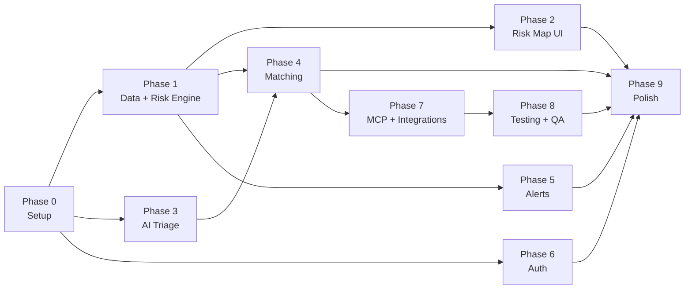

# FloodSaathi — Implementation Plan

> **Hackathon Edition** · 24–48 h build · Grounded in AGENTS.md · PRD.md · ARCHITECTURE.md
>
> **Legend:** 🔴 Must · 🟡 Should · 🟢 Nice-to-have
>
> **Rule:** Do NOT start a phase until the previous phase's Must tasks are green.
> Run `streamlit run app.py` and `pytest tests/ -v` after every phase.

---

## Phase 0 — Setup & Initialisation
**Estimated time:** 1–2 h · **Depends on:** nothing

### Tasks
- [x] 🔴 Create full folder structure from ARCHITECTURE.md
- [x] 🔴 Write `requirements.txt` (streamlit, folium, streamlit-folium, pandas, requests, scikit-learn, anthropic, pydantic, python-dotenv, pytest, ruff, black, bcrypt, plotly)
- [x] 🔴 Write `.env.example` with all keys from ARCHITECTURE.md (ANTHROPIC_API_KEY, DB_PATH, CACHE_DIR, CACHE_TTL_WEATHER_H, CACHE_TTL_FACILITIES_H, OPEN_METEO_BASE_URL, OPEN_METEO_FLOOD_URL, OVERPASS_URL, NOMINATIM_URL, OPENTOPODATA_URL, DEFAULT_DISTRICT, LOG_LEVEL)
- [x] 🔴 Write `.gitignore` (.env, __pycache__, *.db, data/cache/, .venv, venv/, *.pyc, .DS_Store)
- [x] 🔴 Write `config.py` — load all settings, fail fast with `ValueError` if required key missing
- [x] 🔴 Write `src/utils/logging_setup.py` — structured logging, level from env
- [x] 🔴 Write `src/db/schema.sql` — all 9 tables ✅ (already done)
- [x] 🔴 Write `src/db/init_db.py` — create DB + seed ✅ (already done)
- [x] 🔴 Write `app.py` — minimal Streamlit entry point, shows app name + seeded district
- [x] 🔴 Write `tests/conftest.py` — `load_dotenv()`, temp DB fixture
- [x] 🔴 Write `tests/test_smoke.py` — one smoke test: DB file exists after init, app imports cleanly
- [x] 🟡 Write `Makefile` with `install`, `run`, `test`, `lint`, `fmt`, `init-db` targets
- [x] 🟡 Write `scripts/` directory with `run.sh` / `run.bat` equivalents
- [x] 🟢 Write `pyproject.toml` — configure ruff + black line-length 100

### Files to Create
```
app.py
config.py
requirements.txt
.env.example
.gitignore
Makefile
pyproject.toml
src/__init__.py
src/utils/__init__.py
src/utils/logging_setup.py
src/data/__init__.py
src/risk/__init__.py
src/triage/__init__.py
src/matching/__init__.py
src/db/__init__.py
src/alerts/__init__.py
src/integrations/__init__.py
pages/.gitkeep
data/cache/.gitkeep
data/seed/.gitkeep
data/test_requests.json      (empty [])
tests/__init__.py
tests/conftest.py
tests/test_smoke.py
scripts/make_synthetic_requests.py  (stub)
docs/                        (directory)
mcp_server/                  (directory stub)
```

### Demo-able Result
```
$ python src/db/init_db.py   →  "✅ Database ready. 10 districts, 100 requests seeded."
$ streamlit run app.py       →  Browser opens, shows "🌊 FloodSaathi is running — District: Morigaon"
$ pytest tests/ -v           →  1 passed, 0 failed
```

### Cut if Short on Time
- 🟢 `pyproject.toml` — use inline ruff/black flags instead
- 🟡 `Makefile` — document commands in README only

---

## Phase 1 — Data Layer + Risk Engine
**Estimated time:** 3–4 h · **Depends on:** Phase 0 ✅

### Tasks
- [ ] 🔴 `src/data/fetcher.py` — generic `fetch(url, params, cache_key, ttl_h)`: timeout=5, 2 retries with backoff, write/read JSON cache, return dict or None
- [ ] 🔴 `src/data/weather.py` — `get_forecast(lat, lon) -> pd.DataFrame` — 48 h hourly precip from Open-Meteo; fallback to `data/cache/weather_cache.json`
- [ ] 🔴 `src/data/flood.py` — `get_discharge(lat, lon) -> pd.DataFrame` — 48 h discharge from Open-Meteo Flood API; same cache pattern
- [ ] 🔴 `src/data/elevation.py` — `get_elevation(lat, lon) -> float | None` — OpenTopoData SRTM; cache 7 days
- [ ] 🔴 `src/data/geocoder.py` — `resolve(text) -> tuple[float, float] | None` — Nominatim, rate-limit 1 req/s, 7-day cache, fallback to district centroid from DB
- [ ] 🔴 `src/data/grid.py` — `generate_grid(district_id) -> list[dict]` — 10–20 points in district bbox
- [ ] 🔴 `src/risk/engine.py` — `score(precip_48h, discharge, elevation_m, population) -> RiskScore` with named tuple of (level, score_raw, factors dict)
- [ ] 🔴 `src/risk/explainer.py` — `explain(factors) -> str` — picks dominant factor, returns English sentence
- [ ] 🔴 `src/risk/engine.py::compute_all_districts()` — loops districts, fetches data, scores, upserts DB
- [ ] 🔴 `src/db/queries.py` — CRUD for all tables: `upsert_risk_score`, `list_districts`, `get_latest_risk`, etc.
- [ ] 🔴 Write `data/cache/fallback.json` — hardcoded synthetic weather + discharge values for offline demo
- [ ] 🔴 `tests/test_risk.py` — ≥ 5 unit tests: zero rain, max rain, discharge spike, low elevation, all-zero
- [ ] 🟡 `src/risk/ml_model.py` — stub class with `fit()` and `predict()` no-ops (for future)
- [ ] 🟢 Validate formula against 2024 Assam IMD bulletin (manual cross-check, log result)

### Files to Create / Modify
```
src/data/fetcher.py
src/data/weather.py
src/data/flood.py
src/data/elevation.py
src/data/geocoder.py
src/data/grid.py
src/risk/engine.py
src/risk/explainer.py
src/risk/ml_model.py        (stub)
src/db/queries.py
data/cache/fallback.json
data/cache/weather_cache.json    (seed with 1 sample)
data/cache/flood_cache.json      (seed with 1 sample)
tests/test_risk.py
```

### Demo-able Result
```python
from src.risk.engine import compute_all_districts
results = compute_all_districts()
# → [{'district': 'Morigaon', 'level': 'severe', 'explanation': '...', 'score_raw': 0.87}, ...]
```
All 5 risk unit tests pass.

### Cut if Short on Time
- 🟢 `ml_model.py` — pure stub, skip entirely
- 🟡 Elevation data — hardcode elevation=10 m (low-lying) for all demo districts if OpenTopoData is slow

---

## Phase 2 — Risk Map UI
**Estimated time:** 2–3 h · **Depends on:** Phase 1 ✅

### Tasks
- [ ] 🔴 `pages/1_Risk_Map.py` — Folium map, coloured CircleMarker per district using risk level colours from DESIGN.md
- [ ] 🔴 Popup per marker: district name, risk badge, explanation sentence, rain/discharge values, computed_at timestamp
- [ ] 🔴 Sidebar: district picker (selectbox), layer toggles (hospitals ☑, shelters ☑, volunteers ☑)
- [ ] 🔴 Add facility markers to map (hospital = red cross, shelter = blue house, volunteer = green person)
- [ ] 🔴 District summary cards below map (horizontal scroll): name, risk badge, open request count
- [ ] 🔴 Stale-cache banner when data > 1 h old (`st.warning`)
- [ ] 🔴 Loading spinner during risk computation (`st.spinner`)
- [ ] 🟡 Language toggle (EN / HI) in sidebar — affects badge labels and explanation strings
- [ ] 🟡 `RiskBadge` component: coloured pill with level text; used by cards and popups
- [ ] 🟡 Map legend (coloured squares + labels) as Folium HTML overlay
- [ ] 🟢 WCAG AA contrast check — document in comments

### Files to Create / Modify
```
pages/1_Risk_Map.py
src/utils/components.py    (RiskBadge, risk_color helper)
```

### Demo-able Result
Browser shows a Folium map of India with 10 coloured district circles. Clicking "Morigaon" shows a popup: "**Severe** — River discharge 3× normal + 48h rain > 150 mm." Sidebar layer toggles add/remove hospital markers. Cache banner appears when API is mocked as offline.

### Cut if Short on Time
- 🟢 Language toggle — English only for demo
- 🟡 Layer toggles — always show all markers

---

## Phase 3 — AI Triage (Help Request)
**Estimated time:** 3–4 h · **Depends on:** Phase 0 ✅ (Phase 1 for geocoder)

### Tasks
- [ ] 🔴 `src/triage/validator.py` — Pydantic `TriageResult` model (location_raw, lat, lon, urgency 1–5, need, people_count, vulnerable_groups, summary_en, summary_hi, language, triage_method)
- [ ] 🔴 `src/triage/llm.py` — Claude prompt with JSON-only instruction, untrusted-data framing, retry once on bad JSON, parse with `TriageResult.model_validate_json()`
- [ ] 🔴 `src/triage/fallback.py` — keyword matcher (Hindi + English word lists for each need type and urgency signal), returns partial TriageResult
- [ ] 🔴 `src/triage/triage.py` — orchestrator: try LLM → on failure → fallback; geocode location_raw; save to DB
- [ ] 🔴 `pages/2_Help_Request.py` — text area, 5 example message buttons, submit button, RequestCard showing all triage fields
- [ ] 🔴 Red flash / `st.error` for urgency ≥ 4 requests
- [ ] 🔴 "Fallback mode" banner when Claude unavailable
- [ ] 🔴 `scripts/make_synthetic_requests.py` — generate 100 labelled messages → `data/test_requests.json`
- [ ] 🔴 `tests/test_triage.py` — schema validation test, fallback test on 5 English + 5 Hindi messages
- [ ] 🟡 Raw JSON expander on the parsed result card
- [ ] 🟡 `data/test_requests.json` — 30 items with `expected_urgency` and `expected_need` for accuracy eval
- [ ] 🟢 Streaming Claude response (for perceived speed)
- [ ] 🟢 Auto-detect language and show flag emoji

### Files to Create / Modify
```
src/triage/validator.py
src/triage/llm.py
src/triage/fallback.py
src/triage/triage.py
pages/2_Help_Request.py
scripts/make_synthetic_requests.py
data/test_requests.json
tests/test_triage.py
```

### Demo-able Result
Paste: `"bhaiya paani ghar mein ghus gaya, 5 log hain, ek budhiya hai"` → parsed card renders: Urgency 5 🔴, Need: Rescue, People: 5, Vulnerable: [elderly], Hindi + English summary. Works even with Claude API key removed (fallback mode banner).

### Cut if Short on Time
- 🟢 Streaming response — use standard blocking call
- 🟡 Auto language detection — label field with "auto-detected" text, skip emoji

---

## Phase 4 — Resource Matching
**Estimated time:** 2–3 h · **Depends on:** Phase 1 ✅, Phase 3 ✅

### Tasks
- [ ] 🔴 `src/data/facilities.py` — Overpass query for hospital/shelter/school in district bbox, cache 24 h, fallback to seed data
- [ ] 🔴 `src/matching/haversine.py` — `distance_km(lat1, lon1, lat2, lon2) -> float`
- [ ] 🔴 `src/matching/matcher.py` — `assign(request_id)`: rank by urgency × 2 + people_count, assign nearest available volunteer, shelter, hospital; respect capacity and `available` flag; estimate ETA = distance_km / 0.5 (km per min walking); insert assignments; mark volunteer unavailable
- [ ] 🔴 `src/matching/matcher.py::run_all()` — batch-match all `status=new` requests, deterministic (sort by id before iterating)
- [ ] 🔴 `pages/3_Dashboard.py` — request queue table (urgency sorted), assignments table, Folium map with coloured PolyLines (blue=shelter, teal=volunteer, amber=hospital)
- [ ] 🔴 Sidebar filters: district, urgency level, status
- [ ] 🔴 [Run Matching ▶] button → calls `run_all()` → refreshes tables and map
- [ ] 🔴 Stats sidebar: total open, critical count, available volunteers, available shelters
- [ ] 🔴 `tests/test_matching.py` — haversine accuracy, capacity constraint, urgency ranking, determinism test
- [ ] 🟡 Export CSV button for assignment table
- [ ] 🟡 ETA estimated from road speed (30 km/h) not walking speed
- [ ] 🟢 Auto-refresh matching every 60 s with `st.rerun()`

### Files to Create / Modify
```
src/data/facilities.py
src/matching/haversine.py
src/matching/matcher.py
pages/3_Dashboard.py
tests/test_matching.py
data/cache/facilities_cache.json  (seed with Overpass sample)
```

### Demo-able Result
Dashboard shows a queue of 14 synthetic requests sorted by urgency. Click [Run Matching] → all get assigned in < 10 s. Map draws colour-coded lines from each request pin to its resources. Re-clicking [Run Matching] gives identical assignments (determinism verified).

### Cut if Short on Time
- 🟢 Auto-refresh — manual button only
- 🟡 ETA formula — always use walking speed constant

---

## Phase 5 — Alerts
**Estimated time:** 1–2 h · **Depends on:** Phase 1 ✅, Phase 2 ✅

### Tasks
- [ ] 🔴 `src/alerts/generator.py` — Claude prompt → `(message_en, message_hi)` max 160 chars each, save to `alerts` DB table; fallback to template string if Claude unavailable
- [ ] 🔴 `pages/4_Alerts.py` — district + level selectors, [Generate Alert] button, EN + HI text boxes, mock [Send Alert] button that logs to console + DB, alert history table
- [ ] 🔴 Disclaimer banner: "⚠️ Decision support only — not an official IMD/NDMA alert"
- [ ] 🔴 Alert history table: district, level, channel, sent_at
- [ ] 🟡 Channel selector (public / volunteer / all)
- [ ] 🟡 Auto-trigger alert generation for any district that switches to Severe during risk computation
- [ ] 🟢 Copy-to-clipboard button for alert text

### Files to Create / Modify
```
src/alerts/generator.py
pages/4_Alerts.py
```

### Demo-able Result
Select "Morigaon" + "Severe" → click Generate → two text boxes fill with ≤ 160-char bilingual alert. Click [Send (mock)] → row appears in history table with timestamp. Disclaimer visible at top.

### Cut if Short on Time
- 🟡 Auto-trigger — only manual generation
- 🟢 Copy button — select-all manually

---

## Phase 6 — Authentication & Security
**Estimated time:** 2–3 h · **Depends on:** Phase 0 ✅

### Tasks
- [ ] 🔴 `src/auth/auth.py` — bcrypt password check against `users` table, session token stored in `st.session_state`, `get_role()` helper
- [ ] 🔴 Role model: citizen (no login, can submit + view map), volunteer (login, can view dashboard), coordinator (login, full access including alerts + match trigger)
- [ ] 🔴 Login form in `app.py` sidebar — shown when not authenticated; persists role in session state
- [ ] 🔴 Page guards: `pages/3_Dashboard.py` and alert send button require `role in ("volunteer","coordinator")`; `pages/4_Alerts.py` generate + send requires `role == "coordinator"`
- [ ] 🔴 Input validation: max message length 1000 chars (Pydantic + UI), parameterised SQL only (no f-string queries), prompt-injection framing in triage system prompt
- [ ] 🔴 Rate limit: max 5 triage submissions per session per minute (counter in `st.session_state`)
- [ ] 🔴 Safe error messages: `st.error("Something went wrong")` — no stack traces to UI; traceback to log only
- [ ] 🔴 Secrets audit: `grep -r "sk-" src/ pages/` must return zero results
- [ ] 🔴 Write `SECURITY.md` — threat model table, mitigations, known limitations
- [ ] 🟡 `pip-audit` run — document any CVEs in SECURITY.md
- [ ] 🟡 `tests/test_auth.py` — role check tests, malformed input tests
- [ ] 🟢 `streamlit-authenticator` library (optional; simple session approach is sufficient)

### Files to Create / Modify
```
src/auth/__init__.py
src/auth/auth.py
app.py                   (add login sidebar)
pages/3_Dashboard.py     (add role guard)
pages/4_Alerts.py        (add role guard)
SECURITY.md
tests/test_auth.py
```

### Demo-able Result
Anonymous user sees Risk Map and Help Request only. Login as `coordinator / demo1234` → Dashboard and Alerts pages unlock. Submitting >1000 char message shows validation error. Secrets grep returns empty.

### Cut if Short on Time
- 🟡 `pip-audit` — skip if no network
- 🟢 `streamlit-authenticator` — use plain session state login

---

## Phase 7 — MCP + Integrations
**Estimated time:** 2–3 h · **Depends on:** Phases 1–5 ✅

### Tasks
**MCP (Part A — Dev tooling)**
- [ ] 🟡 Create `.mcp.json` — filesystem server (project root) + SQLite server (floodsaathi.db, read-only)
- [ ] 🟡 Write `docs/MCP.md` — setup instructions for Claude Desktop / Claude Code

**MCP (Part B — Product server)**
- [ ] 🟡 `mcp_server/server.py` — FastMCP server exposing: `get_risk`, `get_forecast`, `triage_message`, `list_open_requests`, `run_matching` (coordinator), `generate_alert` (coordinator)
- [ ] 🟡 `mcp_server/test_mcp.py` — calls each tool, checks JSON output

**Integrations adapter pattern**
- [ ] 🔴 `src/integrations/base.py` — `BaseAdapter` ABC: `fetch()`, timeout, retries, cache, fallback file
- [ ] 🔴 `src/integrations/open_meteo.py` — Forecast + Flood adapter, extends BaseAdapter
- [ ] 🔴 `src/integrations/overpass.py` — Overpass adapter
- [ ] 🔴 `src/integrations/nominatim.py` — Nominatim adapter (User-Agent header, 1 req/s throttle)
- [ ] 🔴 `src/integrations/opentopodata.py` — Elevation adapter
- [ ] 🟡 `src/integrations/ndma_sachet.py` — CAP feed adapter stub, `ENABLE_SACHET=false` feature flag
- [ ] 🟡 `src/integrations/mock_sms.py` — MockSMSSender with same interface as Twilio
- [ ] 🔴 `pages/5_Status.py` — integration health page: each source as Live/Cached/Failed, last-updated time
- [ ] 🔴 `tests/test_integrations.py` — contract tests using saved sample responses (no network hit)

### Files to Create / Modify
```
src/integrations/base.py
src/integrations/open_meteo.py
src/integrations/overpass.py
src/integrations/nominatim.py
src/integrations/opentopodata.py
src/integrations/ndma_sachet.py   (stub)
src/integrations/mock_sms.py      (stub)
pages/5_Status.py
tests/test_integrations.py
tests/fixtures/weather_sample.json
tests/fixtures/flood_sample.json
tests/fixtures/overpass_sample.json
mcp_server/__init__.py
mcp_server/server.py
mcp_server/test_mcp.py
.mcp.json
docs/MCP.md
```

### Demo-able Result
`pages/5_Status.py` shows a table: Open-Meteo ✅ Live, Overpass ✅ Cached (23 h ago), Nominatim ✅ Live. Integration contract tests pass with no network required. MCP server starts: `python mcp_server/server.py`.

### Cut if Short on Time
- 🟢 Full MCP server — skip entirely; include in roadmap
- 🟡 NDMA SACHET adapter — keep as stub only
- 🟢 Mock SMS — stub with `pass` body

---

## Phase 8 — Testing & QA
**Estimated time:** 2–3 h · **Depends on:** Phases 1–7 ✅

### Tasks
- [ ] 🔴 `scripts/eval_triage.py` — run 100 messages from `data/test_requests.json`, compute accuracy for urgency, need, people_count, print confusion matrix, write to `docs/EVAL.md`
- [ ] 🔴 `scripts/eval_risk.py` — replay Kerala 2018 / Assam 2022 rainfall data (from cache), check if model flags High/Severe before known event; report lead time in hours
- [ ] 🔴 Complete `tests/test_risk.py` — ≥ 8 edge cases
- [ ] 🔴 Complete `tests/test_triage.py` — schema validation, fallback, 10 labelled messages
- [ ] 🔴 Complete `tests/test_matching.py` — haversine, capacity, ranking, determinism, < 10 s timing
- [ ] 🔴 `tests/test_auth.py` — role guard, malformed input, rate limit
- [ ] 🔴 Integration test: raw Hinglish → triage → geocode → DB insert → match → assignment (mocked APIs)
- [ ] 🔴 Measure p50 and p95 for request-to-assignment time; add to README.md metrics table
- [ ] 🔴 `docs/QA.md` — 3-minute demo script, offline/fallback test checklist, mobile viewport check, Hindi input check
- [ ] 🟡 `pytest --benchmark` for request-to-assignment timing
- [ ] 🟡 Fix any `ruff` and `black` violations; reach zero warnings
- [ ] 🟢 Load test: 100 concurrent triage submissions (use `concurrent.futures`)

### Files to Create / Modify
```
scripts/eval_triage.py
scripts/eval_risk.py
tests/test_risk.py           (complete)
tests/test_triage.py         (complete)
tests/test_matching.py       (complete)
tests/test_auth.py           (complete)
tests/test_integration.py    (full-flow test)
tests/fixtures/              (API response mocks)
data/test_requests.json      (100 labelled)
docs/EVAL.md
docs/QA.md
README.md                    (fill in metrics table)
```

### Demo-able Result
```
pytest tests/ -v     →  ≥ 25 tests, 0 failures
python scripts/eval_triage.py  →  "Accuracy: urgency 91%, need 93%, people_count 88%"
python scripts/eval_risk.py    →  "Assam 2022: model flagged Severe 6h before peak — ✅"
```

### Cut if Short on Time
- 🟢 Load test — skip
- 🟡 `--benchmark` flag — measure with `time.time()` in the integration test

---

## Phase 9 — Polish & Demo Prep
**Estimated time:** 2–3 h · **Depends on:** All phases ✅

### Tasks
- [ ] 🔴 Record demo GIF (OBS or ShareX): Risk Map → Help Request triage → Dashboard matching → Alert generation; ≤ 90 s
- [ ] 🔴 Fill README.md: metrics table, add demo GIF path, update quick-start to match final commands
- [ ] 🔴 Final `ruff check` and `black` pass — zero violations
- [ ] 🔴 Final `pytest tests/ -v` — zero failures
- [ ] 🔴 Test full quick-start in a clean `venv` from scratch
- [ ] 🔴 Verify app starts without any API key (all fallbacks active)
- [ ] 🟡 Mobile viewport test: open at 375px width; verify single-column layout and readable text
- [ ] 🟡 Hindi input end-to-end test: paste "मेरे घर में पानी घुस गया है" → verify Devanagari displays correctly
- [ ] 🟡 Slide deck: problem, solution, demo screenshot, metrics, roadmap (5 slides)
- [ ] 🟢 Dark-mode CSS overrides in `app.py` to match DESIGN.md colour tokens
- [ ] 🟢 Favicon and custom page title via `st.set_page_config`

### Files to Create / Modify
```
demo.gif                (recorded separately)
README.md               (final update)
docs/SLIDES.md          (optional speaker notes)
app.py                  (st.set_page_config, favicon)
```

### Demo-able Result
A judge can:
1. `git clone` → `pip install -r requirements.txt` → `cp .env.example .env` → `python src/db/init_db.py` → `streamlit run app.py` — all in < 5 min.
2. Watch the demo GIF for 90 s and understand all 4 features.
3. Remove `ANTHROPIC_API_KEY` from `.env` and confirm the app still runs with fallback banners.

### Cut if Short on Time
- 🟢 Dark-mode CSS — skip; default Streamlit theme is acceptable
- 🟡 Slide deck — README alone is sufficient for judges

---

## Dependency Graph



---

## Hour-by-Hour Schedule (48 h)

| Hours | Phase | Key Milestone |
|-------|-------|---------------|
| 0–2   | Phase 0 | `streamlit run app.py` says "FloodSaathi running" |
| 2–6   | Phase 1 | Risk engine unit tests green; API data fetched |
| 6–9   | Phase 2 | Coloured Folium map renders with district popups |
| 9–13  | Phase 3 | Claude triage working; fallback also tested |
| 13–16 | Phase 4 | Matching runs in < 10 s; dashboard shows map lines |
| 16–18 | Phase 5 | Bilingual alert generated and saved |
| 18–21 | Phase 6 | Login guards work; SECURITY.md done |
| 21–25 | Phase 7 | Status page live; MCP server starts |
| 25–30 | Phase 8 | All tests pass; eval scripts run |
| 30–36 | Phase 9 | GIF recorded; README final; clean-venv test passes |
| 36–48 | Buffer | Bug fixes, judge Q&A prep, sleep 😴 |

---

## Overall Cut Strategy

If severely time-constrained, build in this priority order and stop when the clock runs out:

1. **Must ship (judges expect it):** Phase 0 → Phase 1 → Phase 2 → Phase 3 → Phase 4 (basic match) → Phase 5
2. **Drop first:** Full MCP server (Phase 7), load tests (Phase 8)
3. **Drop second:** Auth (Phase 6) — show as roadmap item; run coordinator-only on honour system
4. **Never drop:** Cached fallback for every external call; synthetic data only; basic pytest smoke test

---

> **⏸ WAITING FOR APPROVAL**
>
> This plan is complete. Please review and reply with **"approved"** (or any corrections) before Phase 0 execution begins.
