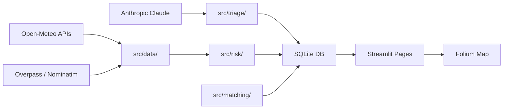

# 🌊 FloodSaathi

> **Real-time flood risk maps, 48-hour forecasts, and AI-powered help-request triage for disaster coordinators in India.**

[](https://python.org)
[](https://streamlit.io)
[](#license)

---

## The Problem

Every monsoon season, floods in Assam, Bihar, and Kerala displace millions. Rescue coordination fails in three predictable ways: **warnings arrive too late**, **help requests scatter across WhatsApp**, and **volunteers have no shared map**. FloodSaathi fixes all three.

---

## Demo

> 📸 _GIF placeholder — insert `demo.gif` here after recording_
>
> 

---

## Features

| # | Feature | What it does |
|---|---------|-------------|
| 🗺️ | **Risk Map** | District grid coloured Low / Medium / High / Severe with a plain-language explanation of the dominant risk factor |
| 📈 | **48-Hour Forecast** | Hourly rain (mm) + river discharge (m³/s) charts per district from live APIs with JSON cache fallback |
| 🆘 | **Help Request Triage** | Paste any Hindi/English/Hinglish message → Claude extracts location, urgency, need, people count, vulnerable groups, bilingual summary |
| 📍 | **Resource Matching** | Nearest shelter, hospital, and volunteer assigned to each request and plotted on the Folium map in < 10 seconds |

---

## Architecture



---

## Tech Stack

| Layer | Library / Service |
|-------|------------------|
| UI | [Streamlit](https://streamlit.io) |
| Maps | [Folium](https://python-visualization.github.io/folium/) + [streamlit-folium](https://folium.streamlit.app/) |
| LLM | [Anthropic Claude](https://anthropic.com) (`claude-3-5-haiku`) |
| Database | SQLite (WAL mode) |
| Data | pandas, scikit-learn |
| HTTP | requests |
| Validation | Pydantic v2 |
| Config | python-dotenv |
| Testing | pytest |
| Linting | ruff + black |

---

## Data Sources

| Source | Data | Link |
|--------|------|------|
| Open-Meteo Forecast | Hourly precipitation, wind speed | [open-meteo.com](https://open-meteo.com) |
| Open-Meteo Flood API | River discharge (48 h) | [flood-api.open-meteo.com](https://flood-api.open-meteo.com) |
| OSM Overpass API | Hospitals, shelters, schools | [overpass-api.de](https://overpass-api.de) |
| Nominatim | Geocoding district / address strings | [nominatim.openstreetmap.org](https://nominatim.openstreetmap.org) |
| OpenTopoData | Elevation (SRTM 30 m) | [opentopodata.org](https://www.opentopodata.org) |

All external APIs have a 5-second timeout, one automatic retry, and a local JSON cache fallback so the **demo never fails offline**.

---

## Quick Start

```bash
# 1. Clone
git clone https://github.com/your-org/floodsaathi.git
cd floodsaathi

# 2. Create virtual environment
python -m venv .venv
source .venv/bin/activate      # Windows: .venv\Scripts\activate

# 3. Install dependencies
pip install -r requirements.txt

# 4. Configure environment
cp .env.example .env
# Open .env and set ANTHROPIC_API_KEY=sk-...

# 5. Initialise database + seed data
python src/db/init_db.py

# 6. Run
streamlit run app.py
```

Open http://localhost:8501 in your browser.

---

## Environment Variables

| Variable | Required | Default | Description |
|----------|----------|---------|-------------|
| `ANTHROPIC_API_KEY` | **Yes** | — | Claude API key |
| `DB_PATH` | No | `floodsaathi.db` | SQLite database file path |
| `CACHE_DIR` | No | `data/cache` | Directory for JSON cache files |
| `CACHE_TTL_WEATHER_H` | No | `1` | Weather cache TTL in hours |
| `CACHE_TTL_FACILITIES_H` | No | `24` | Facilities cache TTL in hours |
| `OPEN_METEO_BASE_URL` | No | `https://api.open-meteo.com/v1` | Override for local testing |
| `LOG_LEVEL` | No | `INFO` | Python log level |

---

## How Risk Is Calculated

Risk score is a weighted composite of four factors:

$$
\text{score} = 0.35 \cdot r_{48} + 0.30 \cdot d_{ratio} + 0.20 \cdot e_{factor} + 0.15 \cdot r_{1h}
$$

| Variable | Definition |
|----------|-----------|
| $r_{48}$ | Normalised 48-hour cumulative rainfall (0–1, saturates at 200 mm) |
| $d_{ratio}$ | River discharge / baseline discharge (capped at 4×, then normalised) |
| $e_{factor}$ | Elevation factor: 1 − (elevation_m / 50), clamped 0–1 (sea-level = 1.0) |
| $r_{1h}$ | Next-hour precipitation intensity (0–1, saturates at 30 mm/h) |

**Thresholds:** score < 0.25 → Low · 0.25–0.50 → Medium · 0.50–0.75 → High · > 0.75 → Severe

**Explainability:** `src/risk/explainer.py` picks the highest-contributing factor and returns a plain-language sentence shown on the map tooltip.

> [!IMPORTANT]
> FloodSaathi is a **decision-support tool**, not an authoritative warning system. It does not replace official IMD / NDMA alerts. All risk levels are estimates based on public forecast data.

---

## Limitations

- Demo data is **fully synthetic**; no real citizen data is stored or transmitted.
- Alert "Send" button is a **mock** — no real SMS is dispatched.
- Risk model uses rule-based thresholds; an ML model is in the roadmap.
- Nominatim geocoding may fail for informal location descriptions.
- Claude API requires an internet connection; keyword-based fallback is less accurate.

---

## Evaluation Results

| Metric | Target | Result |
|--------|--------|--------|
| Triage accuracy (30 messages) | ≥ 90% | _fill after eval_ |
| Request-to-assignment time | < 10 s | _fill after benchmark_ |
| Risk model validation (2024 Assam) | ≥ 3/5 districts correct | _fill after validation_ |
| Map load time | < 4 s | _fill after profiling_ |

---

## Roadmap

- [ ] **WhatsApp Bot** — accept help requests via Twilio WhatsApp API
- [ ] **Offline Mode** — Progressive Web App with service worker; works without internet
- [ ] **NDMA SACHET Integration** — push alerts to the official Common Alerting Protocol feed
- [ ] **ML Risk Model** — replace rule-based scorer with a trained classifier on historical IMD data
- [ ] **Voice Input** — speech-to-text for feature phones (Bhashini / Google STT)
- [ ] **Multi-district Dashboard** — state-level coordinator view

---

## Team

| Name | Role |
|------|------|
| _Your Name_ | Full-stack + AI |
| _Teammate 2_ | Data + Risk Engine |
| _Teammate 3_ | UI/UX + Maps |

---

## License

MIT License — see [`LICENSE`](LICENSE).

> Built at a 48-hour hackathon. Not affiliated with IMD, NDMA, or any government agency.
